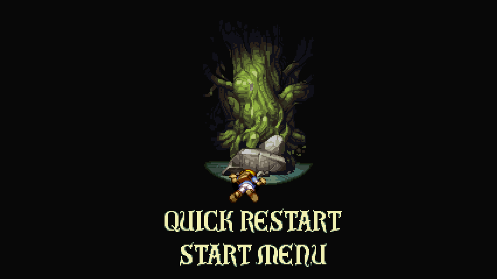
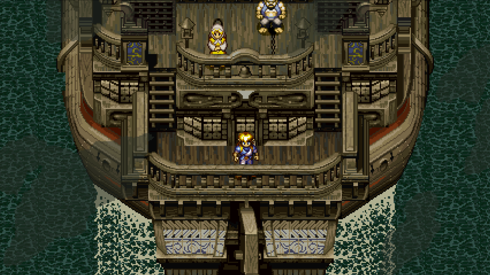
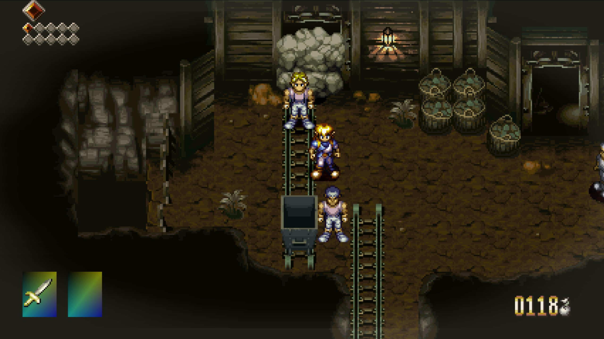
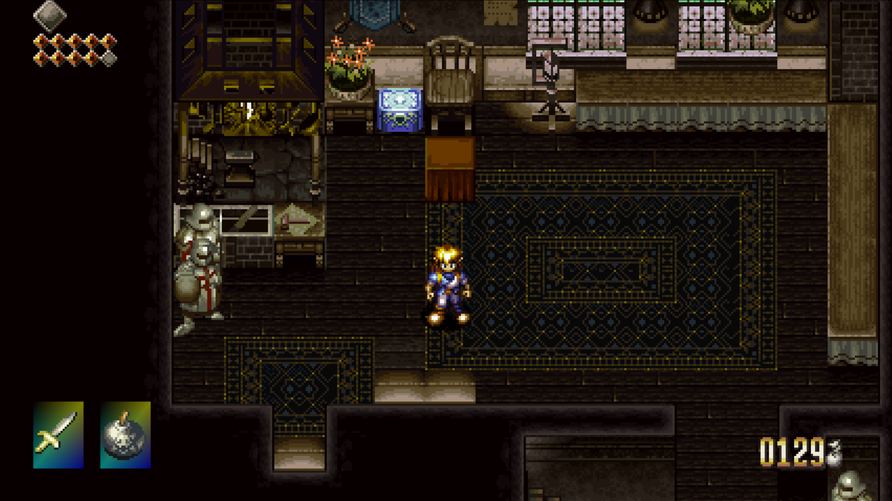
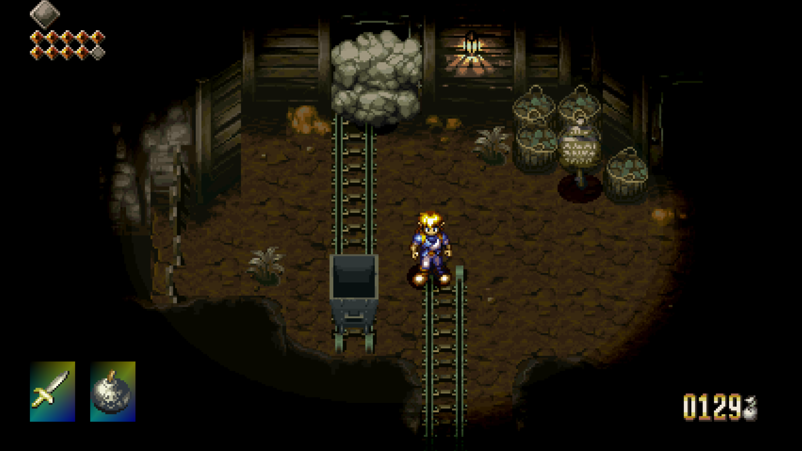

# Alundra

<!-- retcomm-readme-metrics -->
[](https://github.com/RetroPortingToolKit/alundra-recomp/releases)
[](https://github.com/RetroPortingToolKit/alundra-recomp/releases/latest)
[](https://github.com/RetroPortingToolKit/alundra-recomp/releases/latest)
<!-- /retcomm-readme-metrics -->

Static recompilation of **Alundra** built on
[psxrecomp](https://github.com/mstan/psxrecomp) and
[recomp-ui](https://github.com/RetroPortingToolKit/recomp-ui).

Action-adventure by Matrix Software (PlayStation, 1997), recompiled to run natively with modern enhancements.

| | |
|---|---|
| Players | 1 |
| Region | Europe (German, SLES-01256) |
| Publisher | - |
| Year | - |

## What is built in

**Status: actively played.** Every widescreen-related bug found while playing has been fixed.

### 16:9 widescreen (feature `widescreen`)

- **Wide tile renderer:** the game is a pure 2D tile game, so it runs in `full_2d` mode. The main-program tile loop is widened to 21 columns of 24x16 sprites through instruction hooks.
- **Map edge:** maps are 52 columns wide; the column count is clamped at the map edge, so no garbage or streaks appear beyond it.
- **Soft map edge (feature `map_edge_fade`):** a Gouraud subtractive quad (28 px) fades the world smoothly to black at each map side. It is skipped when no bright tiles lie in its zone (small rooms, dark edge tiles).
- **Outside-of-map fill (feature `background_color`):** where the camera shows more than the map, the area is filled in the colour of the edge column (vertical gradient, median-sampled from VRAM). Under the ring/light mask a fixed per-room colour is used; rooms are recognised by a hash of the map rows.
- **Clouds / shadow overlay** widened to the full 16:9 width (28 KB GPU DMA arena).
- **Dark rooms (mine):** the darkness layer only exists for the 4:3 area, so a flat dark (subtractive, ~40 %) quad is added on each side where the layer has full-height edge columns and nothing beyond them. Mine room 3 uses a fixed per-room fill colour.
- **Skeleton rooms:** in two rooms where edge quads/fill flickered or looked like blocks, nothing is drawn at the edge; the background is the game's clear colour.
- **Tile buffer overflow fix:** with two tile layers the 16:9 tile packets overflowed the game's buffer (VRAM noise); both buffers now live in a private arena. Old save states do not load any more.
- **Save/load room fog** covers the whole width without flicker (shifted copies of the 6 fog strips).
- **Ring / light mask** (120 strips) replaced by quads stretched by 4/3.
- **Gate shadow:** the stray black shadow circle under the gate pillar is collapsed.

### Black side bars in 4:3 scenes (feature `pillarbox`, experimental)

For a list of rooms/scenes that are meant to be shown in 4:3 only (no cutscene flag was found), black bars are drawn left and right in the topmost OT slot. Room list: see `mods/alundra_pillarbox.c`.

### Cheat (feature `cheat_infinite_hp`)

Test aid: keeps HP at the maximum. Off by default.

### HUD in the screen corners (feature `hud_corners`)

Item slots bottom left, hearts top left, gilder bottom right. Handles the 10-HP stone (shown above the small HP dots), the start-menu slide (HUD is hidden while it moves) and the different packet layout before the first menu is opened.

### Speed and loading

- **60 fps** instead of PAL 50 Hz.
- **Fast savegame loading:** turbo stays on while the memory card is scanned sector by sector.

### Not yet tested

Sprite/object pop-in at the edges, menus and dialogs with the new HUD, FMV, audio, edge quad on outdoor maps with uniform grass. Interior rooms may have a different map width than 52. Not every room has been checked for the outside-of-map colour.

Features: `widescreen`, `hud_corners`, `background_color`, `map_edge_fade`, `pillarbox`, `cheat_infinite_hp`. Each can be switched off in `mods/state.toml` (`[[feature]] id = "hud_corners"`, `enabled = false`).

## Screenshots

16:9 widescreen with the HUD in the screen corners.

| | |
|---|---|
|  |  |
|  |  |
|  |  |
|  |  |
|  | |

### Common to all recomps in this family

- **60 fps:** PAL titles are forced to NTSC 60 Hz timing (`PSX_FORCE_60HZ=0` restores 50 Hz); the game runs ~20 % faster than on a PAL console.
- **Faster loading:** CD speed-up and turbo while the memory card is being read.
- **16:9** is provided by a trusted mod plugin (fixed display aspect 16:9) together with widescreen culling hooks; each feature can be switched off in `mods/state.toml`.

Scaffolded with the New Project Layout. See
`psxrecomp/docs/GAME_PROJECT_SETUP.md` for the full flow.

<!-- retcomm-readme-launcher -->
## Retro Launcher

You can run this title **standalone** (download the release zip, point it at
your disc, play), or manage installs, updates, and disc/BIOS wiring with
**[Retro Launcher](https://github.com/RetroPortingToolKit/Retro-Launcher)** —
the Retro Compilation Manager hub for self-compiling recomps.

[Downloads](https://github.com/RetroPortingToolKit/Retro-Launcher/releases) ·
[Full README & features](https://github.com/RetroPortingToolKit/Retro-Launcher#readme)

<p align="center">
  
</p>

<p align="center">
  
</p>

Retro checks for updates, installs the prebuilt release zips, and automates
BIOS/ROM/save plumbing so you are not stuck repeating each game’s first run by hand.
<!-- /retcomm-readme-launcher -->

## Legal

You must own the original game. Disc images under `disc/` are gitignored and
must never be committed. Retail BIOS dumps are not redistributed and no C
derived from one may be committed; releases run on the bundled MIT OpenBIOS.

`generated/` (the recompiled game C) **is committed**: releases ship the
compiled game, built by CI from that tree. Regenerate and commit it whenever
seeds or the framework pin change.

Default app icon: `assets/psxrecomp.ico` (and `.png` / `.svg`) — Retro-themed controller mark from `psxrecomp/assets/`. Windows builds embed it via `APP_ICON`.

Optional box art under `launcher_assets/img/` may come from
[libretro-thumbnails](https://github.com/libretro-thumbnails/libretro-thumbnails)
(`Named_Boxarts`); see `BOXART_SOURCE.txt` when present.

## Quick start (dev)

```bash
git submodule update --init --recursive
./psxrecomp/tools/ci/build_emitters.sh
python3 psxrecomp/psxrecomp_cli.py generate \
  --config game.toml --project-root . --disc disc/<your>.cue
git add generated && git commit -m "Regenerate game C"
# Configures, builds, and stages overlay_toolchain/ beside the runtime so
# streamed overlays can be compiled to native shards (a bare cmake build
# skips that stage and leaves every overlay gap interpreted).
python3 psxrecomp/psxrecomp_cli.py rebuild \
  --config game.toml --project-root . --build-dir build-release --no-pgo
```

Official optimized Windows/Linux releases use the maintained shared builder
with the title disc available. Commit the desired `VERSION`, source and
framework pins, then run:

```bash
scripts/package_release.sh --channel public
# Use --channel playtest for a non-public package; --platform selects Windows/Linux.
```

On Windows PowerShell, use
`psxrecomp/tools/package_title_release.ps1 --channel public`. The generated
`packaging/release.toml` and player instructions define the title payload.
The shared builder owns regeneration, qualified build defaults, fresh private
PGO boot training on supported native toolchains, staging and verification.
Boot training is a build step, not gameplay qualification or a performance
claim. See `psxrecomp/docs/RELEASING_A_TITLE.md`.

The separate *Release builds* CI workflow (tag `vX.Y.Z` or dispatch) builds
committed `generated/` C without a disc on Linux, Windows and macOS. It uses
`scripts/package_prebuilt_release.sh` and attaches compiled-game ZIPs. That
explicit prebuilt path does not train selective PGO and is not the official
optimized-release command. The common builder does not add macOS support.

Studio's current Export action still uses the old prebuilt argument contract;
use the shared command above for optimized releases until Studio adopts the
recipe/channel interface. Its packager detection and `packaging/` warning also
need that adoption; the generated recipe is maintained configuration, not a
forked packager.

## Symbols

Progressive map: `symbols.toml` → `python3 tools/sync_symbols.py` →
`psx_symbols.h` (`PSX_FN_*`). See `psxrecomp/docs/SYMBOLS.md`.

## Framework pins

Submodule gitlinks (`psxrecomp`, optional `recomp-ui`, nested `recomp-net`)
are authoritative. `framework_pins.txt` is an optional scaffold snapshot;
release CI logs SHAs with `record_pins.sh` but builds whatever the gitlinks
resolve to. Bump submodules deliberately — do not float on `main`/`master`
in release CI.

<!-- retcomm-readme-raid -->
---

<p align="center">
  <sub><b>R.A.I.D. — Retro AI Development</b> · a Discord for AI-assisted retro reverse-engineering, decomp &amp; recomp</sub>
</p>

<p align="center">
  <a href="https://discord.gg/Ad9BwSzctP"></a>
</p>
<!-- /retcomm-readme-raid -->
